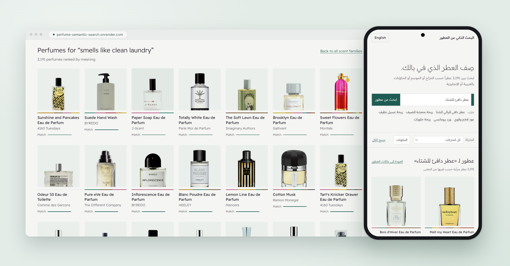
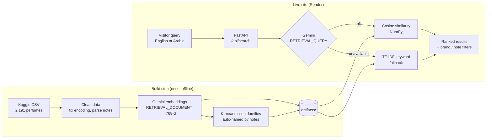
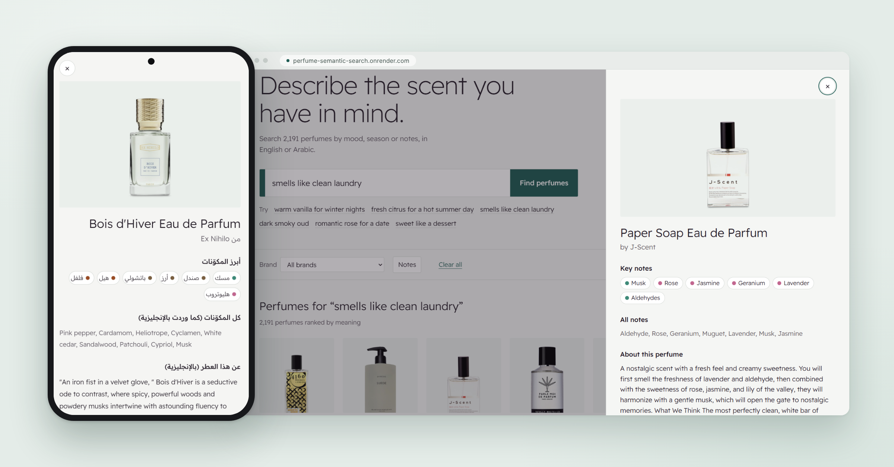

# Perfume Semantic Search

**Describe the scent you want in plain English or Arabic, and get matching perfumes from a catalog of 2,191.** Built with Gemini embeddings, FastAPI and a lightweight bilingual front end, deployed for free on Render.

🔗 **Live demo:** https://perfume-semantic-search.onrender.com



---

## The problem

Online perfume shops let you filter by brand, price or a fixed "family". People don't think about perfume that way. They say *"something warm for winter nights"*, *"smells like clean laundry"* or *"عطر فيه عود وفخم"*. Keyword search can't match those sentences, because the words people type rarely appear in the product data.

## The solution

Every perfume's name and notes are turned into a vector with **Google's `gemini-embedding-001`**. A visitor's sentence is turned into a vector the same way, and perfumes are ranked by **cosine similarity**. The model places Arabic and English in the same vector space, so an Arabic query finds English product data.



## Screenshots



## Features

- **Semantic search in English and Arabic.** Describe a mood, a season or notes; results are ranked by meaning, not shared words.
- **Scent families on the home page.** K-means groups the perfume vectors; each group is named automatically after the notes it over-represents (for example *Oud, Saffron & Rose*).
- **More like this.** Nearest neighbours of any perfume; other sizes of the same scent are skipped.
- **Filters.** Brand, plus notes to include or exclude ("with oud, without vanilla").
- **Resilient by design.** If the embedding API is down or out of quota, search switches to TF-IDF keyword matching automatically, and every other feature keeps working because the perfume vectors are pre-computed.
- **Quota-friendly.** Example queries are embedded at build time, identical catalog texts are embedded once, repeated queries are cached in memory, and responses carry cache headers so browsers reuse them.
- **Bilingual interface** with right-to-left layout for Arabic.
- **Image proxy.** Product images load from the retailer's link; if a browser refuses it, the API fetches the image server-side (catalog URLs only) and the browser caches it for a week.
- **Documented REST API** at `/docs` (OpenAPI).

## Tech stack

| Layer | Tools |
|---|---|
| Embeddings | Google Gemini API (`gemini-embedding-001`, `google-genai` SDK) |
| Search & ML | NumPy (cosine similarity), scikit-learn (K-means, silhouette, TF-IDF) |
| Data | pandas, ftfy (repairs broken text encoding) |
| Backend | FastAPI, Pydantic |
| Front end | HTML, CSS, vanilla JavaScript (no build step) |
| Testing & quality | pytest, Ruff |
| Deployment | Render (free web service, Blueprint in `render.yaml`) |

## Results

**Evaluation set:** 30 queries (15 English, 15 Arabic translations), written before looking at any results ([`data/eval/queries.json`](data/eval/queries.json)). A result counts as relevant if it has one of the notes that define the query. For example, *"smells like clean laundry"* counts musk or aldehydes. Top 10 results per query; full output in [`reports/evaluation.md`](reports/evaluation.md).

| Queries | Semantic search (Gemini) P@10 | Keyword search (TF-IDF) P@10 | Random 10 perfumes |
|---|---|---|---|
| English (15) | **81.3%** | 44.0% | 28.0% |
| Arabic (15) | **77.3%** | 0.0% | 28.0% |
| All (30) | **79.3%** | 22.0% | 28.0% |

- Semantic search put at least one relevant perfume in the top 10 for **every** query (Hit@10 = 100%). Keyword search returned **no results at all for any Arabic query**, because the product data is English.
- Embedding a query through the Gemini API took a **median of 341 ms** (max 608 ms) across the 30 evaluation queries. Example queries are pre-embedded at build time, so clicking one skips the API.
- **Scent families:** the silhouette score stayed between 0.034 and 0.042 for k = 5 to 12, so k = 5 was chosen (sizes 579, 550, 531, 411 and 120). Scores this low mean the groups overlap; they are presented as browsing rows, not strict categories.
- **Images:** 2,191 of 2,191 product image links worked when checked on 31 Oct 2026 ([`reports/images.json`](reports/images.json)).

### Example: "smells like clean laundry"

Top 5 results (semantic mode). None of the five contains the words "clean" or "laundry"; the model matched the idea:

| # | Perfume | Notes |
|---|---|---|
| 1 | Sunshine and Pancakes, 4160 Tuesdays | Cedarwood, citrus fruit, lemons, jasmine, honey, vanilla |
| 2 | Suede Hand Wash, BYREDO | Bergamot, fresh aldehydes, pear, lily of the valley, violet, crisp amber |
| 3 | Paper Soap, J-Scent | Aldehyde, rose, geranium, muguet, lavender, musk |
| 4 | Totally White, Parle Moi de Parfum | Lilac, wisteria, hawthorn |
| 5 | The Soft Lawn, Imaginary Authors | Linden blossom, laurel, ivy leaves, vetiver, oakmoss, fresh tennis balls |

### Example: "عطر دافي للشتا" ("a warm perfume for winter", Jordanian Arabic)

| # | Perfume | Notes |
|---|---|---|
| 1 | Ta'if, Ormonde Jayne | Saffron, dates, pink pepper, freesia, Ta'if rose, jasmine |
| 2 | Black Afgano, Nasomatto | (no notes listed) |
| 3 | Ta'if Elixir, Ormonde Jayne | Pink pepper, saffron, dates, rose, freesia, orange blossom |
| 4 | Original, Comme des Garcons | Labdanum, cedarwood, cardamom, cinnamon, rose, black pepper |
| 5 | Bois d'Hiver, Ex Nihilo | Pink pepper, cardamom, heliotrope, cyclamen, white cedar, sandalwood |

## Dataset

**[Perfume Recommendation Dataset](https://www.kaggle.com/datasets/nandini1999/perfume-recommendation-dataset)** by Nandini Bansal on Kaggle, license **CC0: Public Domain**.

- 2,191 perfumes, 5 columns: `Name`, `Brand`, `Description`, `Notes`, `Image URL`
- 80 perfumes have no notes; for those, the first sentences of the description are embedded instead.
- Product images are loaded from the retailer's CDN and belong to their owners.

What gets embedded is deliberately short: **name + notes**. The descriptions are marketing stories ("I was on the beach under the sun…") that add noise, so they are shown on the site but not embedded.

| Name | Brand | Notes |
|---|---|---|
| Tihota Eau de Parfum | Indult | Vanilla bean, Musks |
| Velvet Fantasy Eau de Parfum | Montale | Tangerine, Pink pepper, Black coffee, Leather, Violet, Jasmine, … |
| L'homme Accompli Eau de Parfum | Divine | Amber, Leather, Vetiver, Guaiac wood, Styrax, Atlas cedar, … |

A 10-row sample is in [`data/sample/perfumes_sample.csv`](data/sample/perfumes_sample.csv).

## Project structure

```
perfume-semantic-search/
├── app.py                    # entrypoint (uvicorn app:app)
├── perfume_search/
│   ├── config.py             # paths and settings (env-overridable)
│   ├── data.py               # load CSV, repair text, clean names/notes
│   ├── notes.py              # 70 common notes with English/Arabic labels
│   ├── embeddings.py         # Gemini client: batching, throttling, retries, cache
│   ├── keyword.py            # TF-IDF fallback / baseline
│   ├── clustering.py         # K-means + automatic group names
│   ├── build.py              # offline pipeline → artifacts/
│   ├── engine.py             # search, similar, groups, filters
│   ├── api.py                # FastAPI routes
│   ├── evaluate.py           # semantic vs keyword evaluation
│   ├── images.py             # image link checker
│   └── __main__.py           # CLI
├── web/                      # front end (served by FastAPI)
├── artifacts/                # built vectors + catalog (committed, used by the API)
├── data/
│   ├── raw/                  # Kaggle CSV goes here (not committed)
│   ├── sample/               # 10-row sample
│   └── eval/queries.json     # 30 evaluation queries (15 EN + 15 AR)
├── reports/                  # evaluation and image-check results
├── tests/                    # 28 pytest tests, no network needed
├── requirements.txt          # runtime (what the host installs)
├── render.yaml               # Render deployment (Blueprint)
└── requirements-dev.txt      # build, local server, tests
```

## Run it locally

Requires Python 3.11+ and a free Gemini API key from [Google AI Studio](https://aistudio.google.com/apikey).

```bash
python -m venv .venv
source .venv/Scripts/activate        # Windows Git Bash  (macOS/Linux: source .venv/bin/activate)
pip install -r requirements-dev.txt

cp .env.example .env                 # then put your key in .env: GEMINI_API_KEY=...

# put the Kaggle CSV at data/raw/perfume_data.csv, then:
python -m perfume_search build       # embeddings + groups → artifacts/
python -m perfume_search serve       # http://127.0.0.1:8000
```

Other commands:

```bash
python -m perfume_search search "smells like clean laundry"
python -m perfume_search evaluate    # writes reports/evaluation.md
python -m perfume_search check-images
python -m pytest -q
```

Without a key the site still runs, in keyword (TF-IDF) mode.

## Deploy to Render (free)

1. Push the repository to GitHub, **including `artifacts/`**.
2. In Render: **New → Blueprint →** connect the repository. Render reads [`render.yaml`](render.yaml) and asks for `GEMINI_API_KEY`.
3. Deploy. The site is served at `/`, the API at `/api/*`, and its docs at `/docs`. Every push to `main` redeploys.

`vercel.json` is also included if you prefer Vercel.

## API

| Method | Endpoint | Description |
|---|---|---|
| GET | `/api/search?q=&brand=&include=&exclude=&limit=&offset=` | Semantic search (keyword fallback); filters only → A–Z browse |
| GET | `/api/perfumes/{id}` | Perfume details |
| GET | `/api/perfumes/{id}/similar` | More like this |
| GET | `/api/groups` | Scent families with their top perfumes |
| GET | `/api/groups/{id}` | All perfumes in one family |
| GET | `/api/filters` | Brands and notes with counts |
| GET | `/api/health` | Status and whether semantic search is available |
| GET | `/api/image/{id}` | Product image fetched server-side (fallback for blocked links) |

## Limitations

- Product data is English only; Arabic works through the multilingual embedding model, and the keyword fallback cannot match Arabic queries.
- The free Gemini tier counts every text as a request. During the build it allowed 100 texts per minute and 1,000 per day, so embedding the full catalog took three days of quota; the build script throttles itself and resumes from its cache. The same daily quota is shared by live searches.
- The free tier may change; when it is unavailable, search quality drops to keyword matching.
- Scent families come from unsupervised clustering, so the groups overlap and are best read as browsing aids, not official fragrance families.
- Note matching for filters uses a 70-note catalog with whole-word rules, so rare notes are not filterable.
- Product images are hot-linked from the retailer and may disappear; a placeholder is shown instead.
- The free Render instance sleeps after 15 minutes without visitors, so the first visit after that waits about a minute while it starts.

## Future work

- Hybrid ranking that blends keyword and semantic scores for exact product names.
- Price, gender and season data from a real shop catalog (the column mapping in `config.py` already supports another CSV).
- User feedback ("more like this / less like this") to personalise results.
- Image embeddings so a photo of a bottle can be a query.

## License

Code: [MIT](LICENSE). Dataset: CC0 (see above). Product images belong to their owners.
